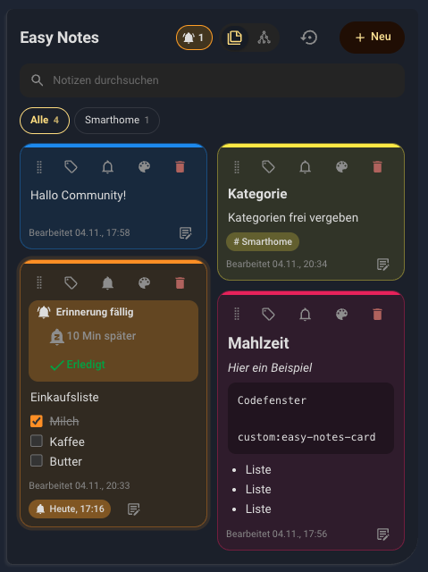
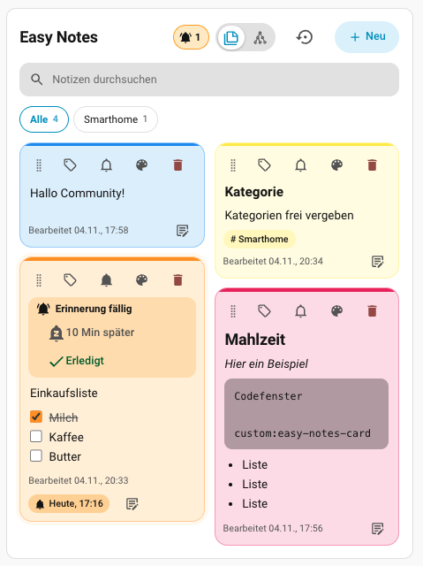
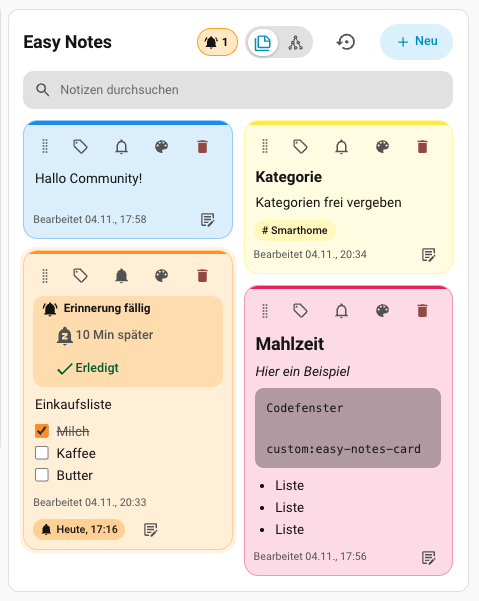
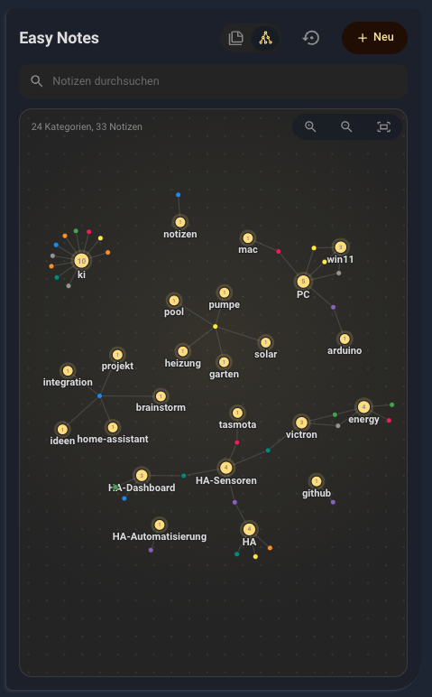

[](https://github.com/hacs/plugin)
[](https://github.com/jayjojayson/easy-notes-card/actions?query=workflow%3Avalidate)
[](https://github.com/jayjojayson/easy-notes-card/releases)

[](https://github.com/jayjojayson/easy-notes-card/blob/main/README.md)
[](https://www.paypal.me/quadFlyerFW)
[](https://github.com/jayjojayson/easy-notes-card/stargazers)


# Easy Notes Card

📝 Die Easy Notes Card ist eine Notiz-Card für Home Assistant. Schreibe schnelle Notizen direkt auf dein Dashboard – mit Markdown, Farben, Kategorien, Erinnerungen, Verschieben per Drag & Drop und einer Netzansicht, die deine Notizen über ihre Kategorien miteinander verbindet.

Die Notizen liegen im **User-Speicher von Home Assistant**: pro Benutzerkonto auf dem Server und damit auf jedem Gerät verfügbar – keine Helfer-Entitäten, keine zusätzliche Integration, kein YAML nötig.

Wenn dir die Card gefällt, freue ich mich über einen Stern ⭐. 🤗

<details>
   <summary> <b>Weitere Bilder der Card</b></summary>

   

</details>

### ✨ Features

**Notizen**
- **Schnelle Notizen**: Mit einem Tipp eine Notiz anlegen und sofort lostippen. Notiz antippen zum Bearbeiten an Ort und Stelle oder im großen Editor öffnen.
- **Markdown-Editor**: Formatierungsleiste (Überschriften, fett, kursiv, durchgestrichen, Code, Aufzählungen, nummerierte Listen, Checklisten, Zitate, Codeblöcke, Links, Trennlinien), Live-Vorschau und Tastenkürzel (`Strg+B`, `Strg+I`, `Strg+K`, `Strg+S`).
- **Farben**: 8 Notizfarben, die dem Home-Assistant-Theme folgen – pro Notiz wählbar oder zufällig von der Card gesetzt.
- **Kategorien**: Gib deinen Notizen bis zu 12 Kategorien und filtere die Liste mit einem Tipp.
- **Suche**: Finde Notizen sofort im gesamten Text.
- **Drag & Drop**: Bringe Notizen in jede Reihenfolge – mit Maus, Touch oder Pfeiltasten.
- **Kachel- und Listenansicht**: Bei breiten Cards kannst du zwischen Kacheln und Liste umschalten.

**Netzansicht**
- **Notizen als Netz**: Kategorien und Notizen werden als verbundenes Netz dargestellt. Notizen mit gemeinsamer Kategorie sind verknüpft – verschieben, zoomen (Mausrad, Buttons oder Pinch auf Touchscreens) und alles einpassen.
- **Schneller Zugriff**: Ein Doppelklick öffnet eine Notiz oder zeigt alle Notizen einer Kategorie.

**Erinnerungen**
- **Erinnerung pro Notiz**: Datum und Uhrzeit wählen oder die Kurzwahlen *In 15 Min*, *In 1 Std* und *Morgen 09:00* nutzen.
- **Später erinnern oder erledigt**: Fällige Erinnerungen erscheinen in der Card – um die eingestellte Zeit verschieben oder als erledigt markieren.
- **Optionale Seitenleisten-Benachrichtigung**: Eine fällige Erinnerung zusätzlich als Home-Assistant-Benachrichtigung in der Seitenleiste anzeigen.
- **Verpasste Erinnerungen** werden beim nächsten Öffnen des Dashboards sofort angezeigt.

**Sichern**
- **Export** aller Notizen als eine Markdown-Datei, als einzelne Markdown-Dateien in einer ZIP oder als Markdown in die Zwischenablage.
- **Import** von Markdown-Dateien, ZIP-Archiven oder ganzen Ordnern – Doppelte werden übersprungen, geänderte Notizen aktualisiert.

**Bedienung**
- **Visueller Editor**: Alles ist im Home-Assistant-UI einstellbar – kein YAML nötig.
- **Lokalisierung**: Deutsch und Englisch (folgt der Home-Assistant-Sprache).
- **Größe**: Breite und Höhe legst du im HA-Layout fest (Sections-Ansicht). Bei automatischer Höhe wächst die Card mit den Notizen, bei fester Höhe scrollt die Notizliste innerhalb der Card.

---

### 🚀 Installation

### HACS (Empfohlen)

- Füge dieses Repository über den Link in Home Assistant hinzu.

   [](https://my.home-assistant.io/redirect/hacs_repository/?owner=jayjojayson&repository=easy-notes-card&category=plugin)

- Die „Easy Notes Card“ sollte jetzt in HACS verfügbar sein. Klicke auf „INSTALLIEREN“.
- Die Ressource wird automatisch zu deiner Lovelace-Konfiguration hinzugefügt.

#### HACS (manuell)
1. Stelle sicher, dass HACS installiert ist.
2. Füge dieses Repository in HACS als benutzerdefiniertes Repository hinzu (Kategorie: *Dashboard* / *Plugin*).
3. Suche nach „Easy Notes Card“ und installiere sie.
4. Lade die Ressourcen neu, falls du dazu aufgefordert wirst.

#### Manuelle Installation
1. Lade `easy-notes-card.js` von der [Releases](https://github.com/jayjojayson/easy-notes-card/releases)-Seite herunter.
2. Lade die Datei in den Ordner `www/community/easy-notes-card/` in Home Assistant hoch.
3. Füge die Ressource in deiner Dashboard-Konfiguration hinzu:
   - URL: `/local/community/easy-notes-card/easy-notes-card.js`
   - Typ: JavaScript-Modul

---

### ⚙️ Konfiguration

Du kannst die ganze Card im visuellen Editor von Home Assistant einrichten – ohne YAML. Füge die Card einem Dashboard hinzu (**Karte hinzufügen → Easy Notes**) und nutze den Editor. Wenn du YAML bevorzugst: Jedes Editor-Feld hat einen passenden Schlüssel, siehe [YAML-Referenz](#yaml-referenz).

#### Schnellstart

Die minimale Konfiguration ist nur der Card-Typ:

```yaml
type: custom:easy-notes-card
```

Alles andere ist optional.

#### Editor-Optionen

| Einstellung | YAML-Schlüssel | Was sie macht |
|---|---|---|
| Titel | `title` | Überschrift der Card. |
| Speicher-Schlüssel | `storage_key` | Name, unter dem die Notizen gespeichert werden. **Cards mit demselben Schlüssel zeigen dieselben Notizen**; ein anderer Schlüssel ergibt einen eigenen Notizsatz. |
| Startansicht | `default_view` | Mit der Notizansicht (`notes`) oder der Netzansicht (`graph`) starten. |
| Suche | `show_search` | Suchfeld anzeigen. |
| Kategorien | `show_categories` | Kategorie-Leiste über den Notizen anzeigen. |
| Anzahl sichtbarer Notizen | `max_notes` | `0` zeigt alle Notizen; sonst nur diese Anzahl, der Rest steckt hinter „Weitere anzeigen“. |
| Notizfarbe | `note_color` | Farbe neuer Notizen: `random`, `yellow`, `orange`, `pink`, `purple`, `blue`, `teal`, `green` oder `grey`. |
| Erinnerungen | `reminders` | Erinnerungen pro Notiz aktivieren. |
| Seitenleisten-Benachrichtigung | `sidebar_notification` | Fällige Erinnerung zusätzlich als HA-Benachrichtigung in der Seitenleiste anzeigen. |
| Schlummerzeit | `snooze_minutes` | Minuten, nach denen eine verschobene Erinnerung erneut erscheint. |

#### YAML-Referenz

```yaml
type: custom:easy-notes-card
title: Easy Notes
storage_key: easy_notes_data   # gleicher Schlüssel = gleiche Notizen
default_view: notes            # notes | graph
show_search: true
show_categories: true
max_notes: 0                   # 0 = alle Notizen
note_color: random             # random | yellow | orange | pink | purple | blue | teal | green | grey
reminders: true
sidebar_notification: false
snooze_minutes: 10
```

#### Wo liegen meine Notizen?

Die Notizen werden über die Home-Assistant-WebSocket-Aufrufe `frontend/get_user_data` und `frontend/set_user_data` gespeichert. Das heißt:

- Die Notizen liegen **auf dem Server, pro Home-Assistant-Benutzer** – sie folgen dir vom Handy zum Tablet und zum Desktop.
- Jeder Benutzer hat eigene Notizen. Zwei Benutzer sehen die Notizen des anderen nicht, auch nicht mit demselben `storage_key`.
- Die Notizen sind Teil deines Home-Assistant-Backups (`.storage`).

#### Erinnerungen – gut zu wissen

Erinnerungen werden **im Browser** geprüft. Sie lösen nur aus, solange ein Dashboard mit dieser Card geöffnet ist (z. B. auf einem Wandtablet). Öffnest du das Dashboard später, werden verpasste Erinnerungen sofort angezeigt.

#### Fehlerbehebung

- **Card wird nicht gefunden / „Custom element doesn't exist“:** Prüfe, dass die Ressource als *JavaScript-Modul* eingetragen ist, und leere den Browser-Cache (`Strg+F5`).
- **Notizen fehlen auf einem anderen Gerät:** Stelle sicher, dass du mit demselben Home-Assistant-Benutzer angemeldet bist und die Cards denselben `storage_key` nutzen.
- **„Die Notizen konnten nicht gespeichert werden“:** Die Verbindung zu Home Assistant war unterbrochen. Die nächste Änderung versucht es erneut.
- **Erinnerung löst nicht aus:** Das Dashboard muss in einem Browser geöffnet sein (siehe oben).

---

## 🙌 Mitwirkende

Danke an alle, die mit Ideen, Fehlermeldungen und Code helfen, die Card zu verbessern. Ideen und Feedback sind jederzeit willkommen – eröffne ein [Issue](https://github.com/jayjojayson/easy-notes-card/issues).

- [**jayjojayson**](https://github.com/jayjojayson) — Autor

---

📜 [Changelog](CHANGELOG.md) · [Changelog (English)](changelog_eng.md) · 📄 [MIT-Lizenz](../LICENSE)
